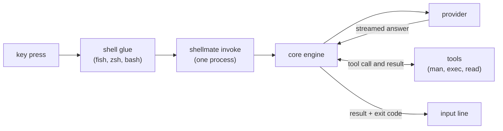

This page is the overview. Each part has its own page with the details:

| If you want to know | Read |
|---|---|
| Every step from key press to answer, in order | [Life of a request](../request-lifecycle/) |
| The kinds of plugin, when each is called, which are required, how many you can have | [Plugins](../plugins/) |
| How the middleware chain, redaction and provider fallback work | [The LLM pipeline](../llm-pipeline/) |
| How the model asks for a tool, the loop, and the checks on each call | [Tool calling](../tool-calling/) |
| What the model is told, and how levels and trust limit it | [Context and prompts](../context-and-prompts/) |
| How a suggested command is checked | [Command checks](../command-checks/) |
| Conversations, captures, the audit log and every file on disk | [State on disk](../state-and-storage/) |
| How the answer reaches your terminal | [Output and presentation](../output-and-presentation/) |
| What the shell integration does and the protocol it speaks | [Shell glue](../glue-protocol/) |
| Where each piece lives in the source tree | [Module guide](../module-guide/) |
| The rules that always hold | [Security model](../security-model/) |

## One request, end to end

1. The shell glue collects the prompt state (your text, cursor, directory, last status, recent commands, session id) and writes it to a private file.
2. It runs `shellmate invoke`, a short-lived process, with that file as input.
3. The core builds a prompt for the action, applies the context level, and walks the **provider chain**. For each provider the whole request is rebuilt: the context is capped to that provider's ceiling, the conversation history is assembled for its trust, and middleware such as redaction wraps the call.
4. The answer streams back. A word-wrapping, append-only renderer writes it to your terminal; the part of the reply that is a command is held back and placed in your input line.
5. If the model asks for a tool, the call is checked (grammar, classifier, your rules, your approval), run, and its result is fed back to the model in the next round, up to `max_tool_rounds` rounds. See [Tool calling](../tool-calling/).
6. The suggested command is checked, the turn is stored in the conversation, and a content-free line is written to the audit log.

A run takes about 8 ms before any network traffic (p50, with a 30 ms budget enforced in CI).

## Plugins and tools

The core is small: the pipeline, the config, the invariants. Providers (chat and decision models), middleware (such as redaction) and conversation stores are plugins that depend only on the plugin API crate. The first-party ones are compiled into the binary as modules of one crate, `shellmate-builtin`, and registered through cargo features, using the same API an outside plugin would. The tools (`man`, `help`, `exec`, `read`) are plugins too, but the core runs them: it keeps approval, pre-approval, taint and escaping, so a tool cannot skip them. [Plugins](../plugins/) explains when each kind is called and how many of each you can have.

| Plugin | Kind | What it does |
|---|---|---|
| `builtin:openai-compatible` | Provider | Talks to OpenAI-compatible servers, with streaming. |
| `builtin:systemone` | Decider | Asks a decision model (any `POST /v1/systemone` endpoint) whether a suggested command matches the request and how dangerous it is. |
| `builtin:redact` | Middleware | Replaces secrets with placeholders on the way out and restores them on the way back. |
| `builtin:store-tmpfs` | Store | Keeps conversations on tmpfs. |
| `man` | Tool (in the core) | Shows the model a manual page. Accepts only `man [section] page`. |
| `help` | Tool (in the core) | Runs `program [subcommand] --help` and shows the model the text, after your approval or a rule you wrote for that program. |
| `exec` | Tool (in the core) | Runs one simple command to look at your machine, after your approval. |
| `read` | Tool (in the core) | Reads one text file from the working directory or `[tools.read] roots`, after your approval. |

Each tool is one self-contained piece of the core. It carries what is specific to it: how it decides whether a call may go ahead (`exec` and `read` ask you first), how it runs, and the instructions that tell the model it exists. Turning a tool off in the config also removes its instructions from the prompt.

Middleware is an onion: each layer can act before and after the stage it wraps. That shape is what lets redaction share a mapping between the outbound request and the streaming reply.

## Invariants

A handful of rules hold regardless of configuration or plugins. They are enforced in the core and covered by tests.

- **INV-1:** executing a command on the model's behalf requires human approval, unless it matches a pre-approval rule that you wrote yourself and no classifier flags it. Plugins can only make approval stricter, never skip it.
- **INV-2:** a request cannot reach a network provider unless it has gone through the outbound chain to completion. A remote provider is refused when no redaction layer is active.
- **INV-3:** plugins only get the permissions they declare and you grant.
- **INV-4:** once a turn has read untrusted content from the outside (the web, for example), your pre-approval rules are suspended and every execution asks.

INV-1 and INV-2 are enforced in code today. INV-3 and INV-4 matter once external plugins and network tools exist. Separately, the context level sent to a provider is always capped at that provider's ceiling.

## Oneshot now, daemon later

Each request is a new process. This keeps the design simple and avoids a long-lived process holding your secrets. A background daemon is planned for faster starts and for features that need state; the plugin API is designed so that this will not change how plugins are written.

## What the core can see

The core reads environment variables, the clock and files through three small ports (`Env`, `Clock` and `Fs`, bundled as `Host`). Tests give it a fixed `PATH`, a fixed time and an in-memory file system, so they never depend on the machine. Audit events go through a fourth port, `AuditSink`.

The environment that an `exec` command receives is built from the same `Env` port (only an allow list of variables is copied; the "inherit" setting passes the real environment on purpose).

Some things use the real system on purpose: starting programs (`exec`, `man`, `git`), the path checks of the `read` tool (symlinks and `..` must be resolved by the real file system to mean anything), and anything that writes (the audit log, captures, conversation stores).

## Source layout

The [Module guide](../module-guide/) lists every module and what it is responsible for. The top level:

| Path | What |
|---|---|
| `crates/shellmate-api` | The plugin API (traits, types, registry) |
| `crates/shellmate-core` | The engine (`engine/`, split by concern), config, prompts, conversations, tools, the command classifier, the validator, audit, the presenter that draws what you see (`present/`), and the ports for the environment, clock and files (`ports.rs`) |
| `crates/shellmate-builtin` | The first-party plugins, one module each behind a cargo feature (provider-openai-compatible, decider-systemone, middleware-redact, store-tmpfs), and the registry that lists them |
| `crates/shellmate` | The binary: the command line (`cli.rs`), one module per command (`commands/`), setup, doctor and the other admin commands (`admin/`), the approval prompt, the terminal |
| `crates/shells/` | Glue templates for fish, zsh and bash |
| `tools/e2e/` | The real-shell conformance suite and a mock provider |
| `tools/bench/` | Performance and model benchmarks |
| `tools/mutants.sh` | Mutation testing of the security modules |
| `tools/shellmate-testing/` | Mock servers, a fake provider and an in-memory conversation store for tests |
| `tools/spikes/` | Archived experiments from the design phase |
| `.github/workflows/` | CI, release and website deployment |
| `website/` | This documentation site |
| `assets/` | Logos |
