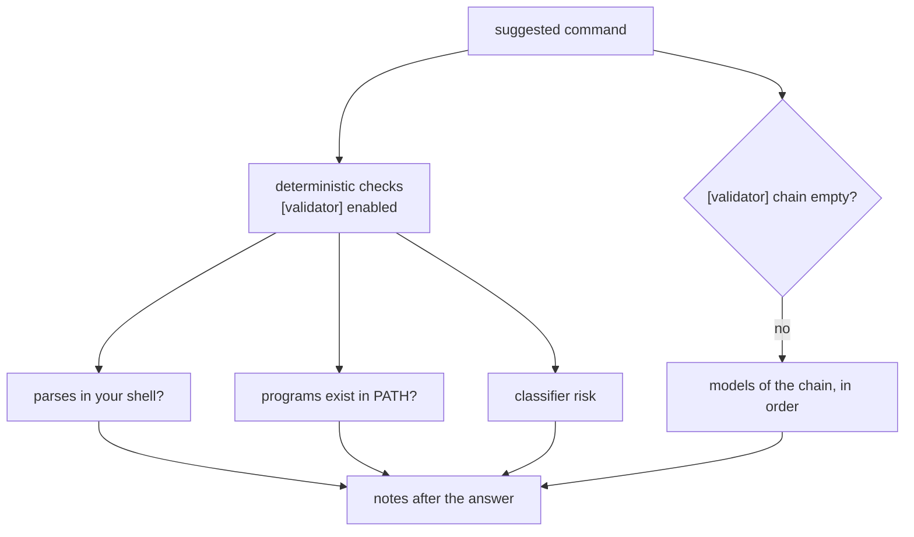
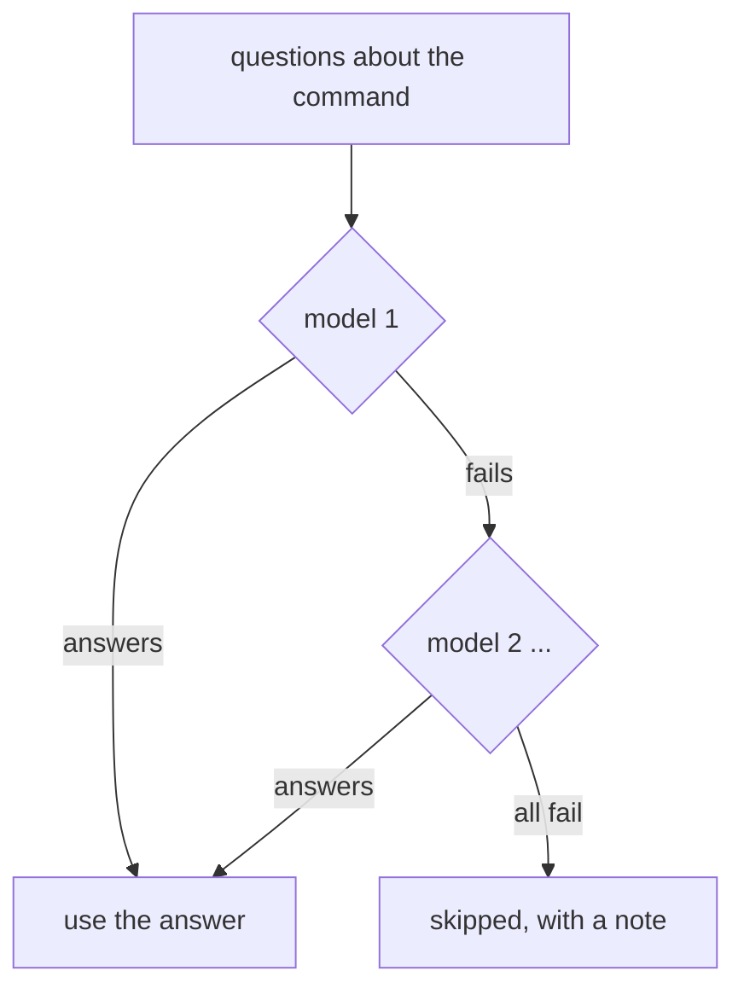

When `ask` or `generate` suggests a command, shellmate checks it before putting it in your input line. The checks are **advisory**: they add notes after the answer, above the input line that holds the command, and the command is still placed in the line. You decide. Nothing in this page can approve anything.

The same parser and classifier also gate the `exec` tool, which is where they can veto. That part is in [Tool calling](../tool-calling/). For the user view of the checks, see [Checking suggested commands](../../guides/validator/).



## Deterministic checks

On by default (`[validator] enabled`). They need no model and run in a few milliseconds.

| Check | How | Note shown |
|---|---|---|
| Syntax | Runs `<shell> -n -c <line>` with the shell you use (bash, zsh or fish). `-n` reads the line and runs nothing. The environment is cleared, stdin is closed and there is a 2 second limit. An unknown or missing shell skips the check. | "this does not parse in fish: ..." |
| Programs exist | Splits the line into simple commands at `|`, `&`, `;` and newlines (respecting quotes), and looks each program up in `PATH`. Shell builtins, names with a `/`, and segments that are not simple are skipped. Skipped when the syntax check failed. | "`x` was not found in PATH (it may be an alias or function)" |
| Risk | Runs the risk classifier on the whole line. Reported when the risk is medium or high and there is a specific reason. | "high risk: ..." |

## The command parser and classifier

Both live in `command/` and are deterministic and conservative.

### The strict parser

A line is a **simple command** only if it holds no shell syntax at all. The accepted subset is what bash, zsh and fish parse the same way: plain words, literal single and double quotes, spaces and tabs. Everything else is refused, with a reason:

| Refused | Examples |
|---|---|
| Operators | `\|`, `&`, `;`, `<`, `>`, `(`, `)` |
| Expansions and special characters | `$`, backtick, `*`, `?`, `[`, `{`, `~` at the start of a word, `#`, `!` |
| Backslashes, control characters, unterminated quotes | |
| Variable assignments, `=cmd` | `FOO=1 ls` |
| Shell keywords and builtins | `if`, `for`, `cd`, `eval`, `source`, `exec`, `set`, `export` |
| Non-ASCII characters outside quotes | |

### The classifier

`classify` rates a line **low, medium or high**, with reasons. It can only make things stricter: `Safe` approves nothing by itself, and anything it does not understand needs a human.

- A line that is not a simple command is medium by definition. Its words are still looked at so the reasons are specific.
- **High:** programs that destroy files, `sudo` and similar, stopping processes or the system, programs that run other programs or arbitrary code, `systemctl` and friends with anything but a read-only verb, `find` with `-exec` or `-delete`, `sed -i`, `git -c`, package managers that install or remove, `ln -f`, and any path that looks like credentials.
- **Medium:** programs that use the network, many `git` verbs that change a repository or fetch (`push`, `reset`, `commit`, `pull`, ...), and `sed` scripts that may run commands.

### Pre-approval rules

`[tools.exec] preapproved` holds rules you wrote, such as `git status` or `ls *`. Tokens are matched one to one, `*` and `?` are wildcards inside a token, and a trailing `*` matches any remaining arguments. The program must be named: a rule whose first token is only wildcards matches nothing.

`shellmate config check` reports rules that are too broad. They still work, because the classifier keeps its veto: a rule can never approve something the classifier flags.

You can try the whole thing without running anything:

```sh
shellmate check 'git push --force origin main'
shellmate check --json 'ls -la'
```

## The semantic check

Off by default. With a non-empty `[validator] chain`, a model also answers two typed questions about the command:

| Question | Type | Asks |
|---|---|---|
| `match` | yes or no | Does the proposed command do exactly what the request asks, and nothing beyond it? |
| `risk` | one of `read_only`, `changes`, `destructive` | How dangerous is running it on your machine? |

The record sent holds three fields: your request, the proposed command, and your shell. The labels are fixed, so any decision model can be pointed at them.



1. The models in `[validator] chain` are tried **in order**. A decision model on a `local` provider gets the record as is. One on a `remote` provider gets it only after it has passed through the `llm` middleware chain, so it is redacted like any other outbound text. If the chain changes the record's shape, the call is refused.
2. A chat model in the chain answers the same questions as a chat request. The record is delimited and labeled as data, the reply must be a single JSON object, and anything unreadable counts as no answer, never a guess. This too goes through the middleware chain.
3. The whole check has a limit (`[validator] timeout`, default 5 s). A failure or a timeout adds the note "the semantic check was skipped: ..." and never blocks the answer.

Only confident findings are shown (`[validator] min_confidence`, default 0.8, range 0.5 to 1):

- "this may not be what you asked for (N% sure)" when the model is sure the answer to `match` is no.
- "rated destructive by the check model (N% sure)" when `risk` is `destructive`. This is left out if the deterministic risk check already said something.

## What is recorded

One `validation` audit event per request, with the number of notes and who answered (`off`, `model:<name>`, `failed` or `timeout`). Never the notes or the command. See [Audit log and --explain](../../guides/audit/).
