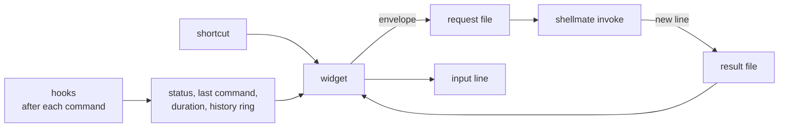

The shell glue is the only part of shellmate that lives inside your shell. It is deliberately thin: it collects what the shell knows, hands it to the binary, and puts the result in your input line. Anything that can be tested is in the Rust binary.



## What gets installed

`shellmate setup` (or `shellmate install-shell`) adds one block to your shell's rc file, between two marker lines:

```text
# >>> shellmate >>>
... one line that evaluates the output of `shellmate init <shell>` ...
# <<< shellmate <<<
```

Running `install-shell` again updates the block in place, and `install-shell --remove` takes it out. For bash the block goes last, after prompt tools, so the glue can see the exit status of your command first.

`shellmate init <shell>` prints the glue. It is generated from a template for the shell (`crates/shells/<shell>/`) by filling in three things:

| Placeholder | Filled with |
|---|---|
| `@BIN@` | The path to the `shellmate` binary |
| `@SESSION@` | A fresh session id: 16 hex characters from `/dev/urandom` |
| `@BINDINGS@` | The key bindings, one per entry of `[input.shortcuts]` |

Because `init` runs every time a shell starts, each interactive shell gets its own session id. That id is exported as `SHELLMATE_SESSION` and is what ties requests to a conversation. See [State on disk](../state-and-storage/).

## What the glue keeps track of

After each command runs, a hook records:

- the exit status of the command (the hook must run **first** among your prompt hooks, so `$?` is still the user's),
- the command text,
- how long it took (`CMD_DURATION` in fish, `EPOCHREALTIME` in zsh and in bash 5 and later),
- a ring of the last 10 commands, each as `<status>\t<command>`.

The glue forwards all of it. The binary decides which of it to use: `[context] history_lines` of the ring, and only at context level 2 and above.

## The widget

When you press a shortcut, the widget for that action runs:

1. Moves below your input line and clears the area, so the answer appears under the line you typed.
2. Writes the **envelope** to `<runtime dir>/<shell pid>.in`.
3. Runs `shellmate invoke` with that file as stdin and `<shell pid>.out` as stdout.
4. Empties the request file.
5. If the exit code is `0`, replaces the input line with the result file and moves the cursor to the end.
6. Redraws the prompt.

The runtime directory is `$XDG_RUNTIME_DIR/shellmate`, or `/tmp/shellmate`, created with mode `0700`.

The binary is run as a plain single-process job with files for input and output, not in a pipeline or a command substitution. A pipeline would fork the shell builtin, and that fork would die on Ctrl-C, making the shell abort the whole widget. A command substitution is cancelled the same way. With files, Ctrl-C reaches only the binary, and there is one fork per call.

## The envelope

NUL-terminated `key=value` fields on stdin. `buffer` is the last field and may contain newlines.

| Field | Meaning |
|---|---|
| `v` | Protocol version. Must be `1` (`glue.version` otherwise) |
| `action` | `ask`, `generate`, `explain`, `new-conversation` or `capture`. Required |
| `shell` | `fish`, `zsh` or `bash` |
| `shell_version` | The shell's version |
| `cwd` | The working directory |
| `cursor` | The cursor position, in characters |
| `status` | Exit status of the last command |
| `last_command` | The last command |
| `duration_ms` | How long the last command took |
| `hist` | One field per history entry: `<status>` TAB `<command>` |
| `session` | The session id. Empty means stateless |
| `buffer` | The input line |

Fields the binary does not know are ignored, so a newer glue works with an older binary. A field without `=` is a protocol error. The input line may be at most 64 KiB (`input.too_large`).

## Exit codes

| Code | Meaning | What the glue does |
|---|---|---|
| `0` | The result is a new input line, on stdout | Replace the line |
| `10` | Nothing to put in the line | Leave it |
| other | An error, already shown on the terminal | Leave it |

## Key bindings

`[input.shortcuts]` maps a key to an action:

```toml
[input.shortcuts]
"alt+m" = "ask"
"alt+i" = "generate"
"alt+j" = "explain"
```

A key is a single letter or digit with `ctrl`, `alt` or both. A bare key is refused, because it would break typing. Chords such as `ctrl+x ctrl+e` and punctuation keys are not supported yet. A key that maps to an unknown action is a config error.

`init` turns each entry into the shell's own syntax (fish `bind`, zsh `bindkey` for emacs and vi modes, bash `bind -x` for emacs and vi modes). Before binding, it checks whether the key is already bound, and if it is, **prints a message and leaves the existing binding alone**. It never silently overrides one.

## Differences between shells

| | fish | zsh | bash |
|---|---|---|---|
| Hooks | `fish_postexec` event | `preexec` and `precmd` | `PS0` and `PROMPT_COMMAND` |
| Minimum version | | | 4.4 (it needs `PS0`) |
| Command duration | `CMD_DURATION` | `EPOCHREALTIME` (the `zsh/datetime` module) | `EPOCHREALTIME`, bash 5.0 and later only |
| Redraw | `commandline -f repaint` | `zle -R` | The prompt and line are drawn again before the output |

Older shells, powerlevel10k and macOS are untested. See the [roadmap](../roadmap/).

## The `capture` action

`capture` never reaches the engine. The binary wraps the input line in `shellmate run --` (or unwraps it if already wrapped), prints the new line, and exits `0`. It uses the bare name `shellmate` if that is the binary on your `PATH`, and otherwise the full path. It refuses lines it cannot wrap safely (with a message, exit `10`).

Nothing is run. When you press Enter, the shell runs `shellmate run -- <your command>`, which runs the command as usual and keeps a copy of its output for your next question. See [Asking about a command's output](../../guides/capture/).
