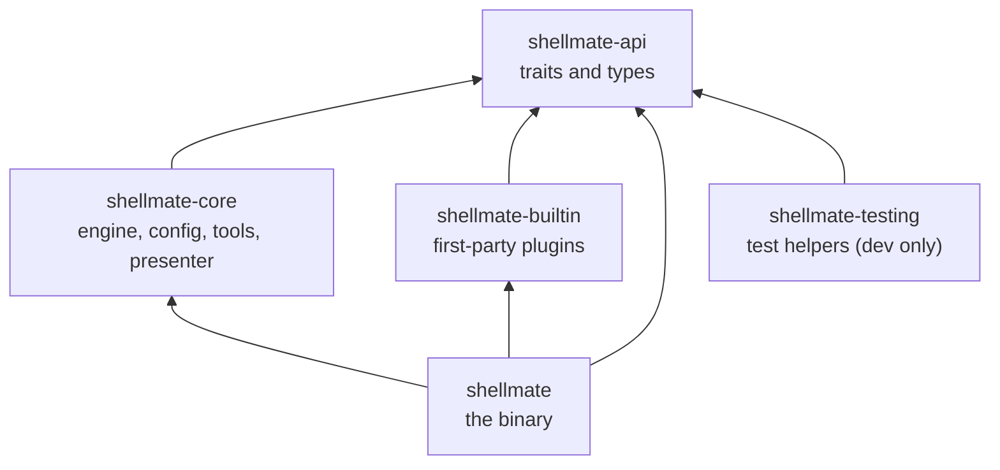

Use this page to find where something lives. For how the parts work together, start with [Life of a request](../request-lifecycle/).

## How the crates depend on each other

The rule that matters is the arrow that is **missing**: plugins depend on `shellmate-api`, never on `shellmate-core`. If a plugin needs something from the core, the API is extended on purpose. The binary is the only crate that sees both the core and the plugins, and it is where they are joined (`Engine::from_config(&cfg, &shellmate_builtin::registry())`).

No crate is published. The binary is released as a tarball.

## `shellmate-api`: the plugin API

Runtime-agnostic: futures appear in signatures through `async_trait`, but no tokio types do.

| File | What it defines |
|---|---|
| `provider.rs` | `Provider` (`info`, `prepare`, `models`, `chat`, `chat_stream`), `ProviderInfo`, `ProviderError` and `ProviderErrorKind`, which decide fallback |
| `decider.rs` | `Decider` (`info`, `models`, `decide`), and the typed `Question`, `DecisionRequest`, `Answer` and `DecisionResponse` |
| `middleware.rs` | `Middleware`, `Next` (the rest of the chain) and `Terminal` (the innermost handler) |
| `store.rs` | `Store`, `ConversationLock`, `Current` and `ConversationInfo` |
| `registry.rs` | `Registry`: constructors by id for each kind of plugin, `MiddlewareRole` (`Redactor`, `Filter`, `Observer`) |
| `types.rs` | `Message`, `Role`, `ChatRequest`, `ChatResponse` and `Usage` |
| `stream.rs` | `StreamEvent` (`Text`, `Usage`, `Done`), `ChatStream`, and helpers to build or collect a stream |
| `secret.rs` | `Secret`, a string that cannot be printed by accident |
| `endpoint.rs` | `check_endpoint`: cleartext `http` only for loopback hosts |
| `error.rs` | `Error` with a code, a message and a hint |

## `shellmate-core`: the engine and everything it needs

### The engine (`engine/`)

One file per concern. `Engine` is defined in `mod.rs`, along with its construction and the privacy gate.

| File | Responsibility |
|---|---|
| `mod.rs` | `Engine`, `from_config`, `check_privacy` (INV-2) |
| `run.rs` | The lifecycle of one request: conversation, provider loop, fallback, checks, saving the turn, building the `Outcome` |
| `attempt.rs` | One provider's turn: stream the reply and run the tool loop |
| `request.rs` | Building the payload for one provider: level, history, tool offers, taint |
| `context.rs` | Gathering the context: the envelope, project, git and capture |
| `preview.rs` | `--dry-run` and `shellmate context`: what would be sent, without sending |
| `semantic.rs` | The command check: deterministic notes and the decision model or LLM |
| `turn.rs` | The audit events of a request, the `--explain` report, saving the turn |
| `terminals.rs` | The innermost handlers of the middleware chain: the provider, and a recorder |
| `lazy.rs` | A provider whose `cmd:` secrets are fetched on first use |
| `types.rs` | What a client sees: `Outcome`, `Report`, `Emit`, `ProviderSpec` and others |
| `tool_calls/` | The host for tools: `plugged.rs` enforces approval, pre-approval, taint and escaping around any `Tool`; `services.rs` is what a tool may use (classifier, path checks, process runner) |

### Tools (`tools/`)

The helpers behind the tool services: parser and runners. The tools themselves (`tool_man`, `tool_exec`, `tool_read`) are modules of `shellmate-builtin`.

| File | Responsibility |
|---|---|
| `call.rs` | `ToolCall`: one line, a name and its words |
| `exec.rs` | Running a command: no shell, a process group, a sanitized environment, a timeout, capped output |
| `read.rs` | Resolving and vetting a path, reading a file, and the delimited result |
| `approval.rs` | `ApprovalRequest`, `Choice` and the `Approver` trait, which only the binary implements |
| `text.rs` | Cleaning text a program wrote: terminal codes out, length capped |

### The command classifier (`command/`)

| File | Responsibility |
|---|---|
| `parse.rs` | The strict parser: a line is a simple command only if it has no shell syntax |
| `classify.rs` | The risk classifier: low, medium or high, with reasons. It can only make things stricter |
| `tables.rs` | The word lists the classifier looks things up in |
| `rules.rs` | Matching your `preapproved` rules, and spotting rules that are too broad |
| `program.rs` | A command ready to run, and finding its program on a `PATH` |

### Configuration (`config/`)

Strict: unknown keys are errors.

| File | Responsibility |
|---|---|
| `mod.rs` | The `Config` struct, the provider chain, the middleware list |
| `sections.rs` | `[runtime]`, `[context]`, `[validator]`, `[pipeline]`, `[ui]`, `[audit]`, `[conversation]`, `[actions]`, `[input]`, `[secrets]` |
| `providers.rs` | `[providers]`, `[deciders]`, `[plugins]` and `Trust` |
| `tools.rs` | `[tools.<name>]`: `enabled`, `approval`, `preapproved`, and the rest passed to the tool |
| `load.rs` | Finding, reading and parsing the file; durations such as `30s` |
| `validate.rs` | Static checks on a parsed config, with no secrets read and nothing built |
| `resolve.rs` | Turning the config into plugin settings: secrets resolved, plugin ids checked, `cmd:` secrets deferred |

### Everything else in the core

| Module | Responsibility |
|---|---|
| `action.rs` | The `Action` enum, with the names the glue sends |
| `envelope.rs` | Parsing the request the glue sends |
| `prompt/` | Assembling the system and user messages |
| `response.rs` | Parsing the model's reply into prose, command blocks and tool blocks, and the streaming display filter |
| `conversation/` | The turn format, which conversation a request continues, and building the history for a provider |
| `collect/` | The project and git collectors |
| `capture.rs` | Output captured by `shellmate run`: storage, the prompt section, and wrapping a line |
| `validate/` | The checks on a suggested command: syntax, programs, risk, the semantic questions |
| `audit.rs` | The audit log and the sink interface |
| `secrets.rs` | Secret references: `env:`, `file:`, `cmd:` and `keyring:` |
| `secret_cmd.rs` | Running a `cmd:` program: no shell, a small environment, a timeout and a size cap |
| `sanitize.rs` | The one function that makes untrusted text safe to show: control characters become visible |
| `render.rs` | Append-only word wrapping for the plain presenter |
| `present/` | The presenter: `types.rs` (notices, remarks, caps), `level.rs` (how much the terminal can show), `plain.rs`, `rich/` (`wrap.rs`, `markdown.rs`), `theme.rs` (looks) |
| `ports.rs` | `Env`, `Clock` and `Fs`, bundled as `Host`, so tests can give the core a fixed machine |
| `limits.rs` | Internal time limits, which `SHELLMATE_TIME_SCALE` can stretch |
| `needs.rs` | Tests that need a program from the machine ask for it here |

## `shellmate-builtin`: the first-party plugins

One module per plugin, each behind the cargo feature of the same name, plus the registry.

| Module | Feature | Plugin id | What it is |
|---|---|---|---|
| `provider_openai_compatible/` | `provider-openai-compatible` | `builtin:openai-compatible` | `settings`, `presets`, `client` (requests), `wire` (replies and error kinds), `sse` (streamed answers) |
| `decider_systemone/` | `decider-systemone` | `builtin:systemone` | A decision model over `/v1/systemone` |
| `middleware_redact/` | `middleware-redact` | `builtin:redact` | `rules` (what is a secret), `mapping` and `redactor` (replace and restore), `middleware` (plugging into the chain and restoring a stream) |
| `store_tmpfs/` | `store-tmpfs` | `builtin:store-tmpfs` | Conversations on tmpfs |

## `shellmate`: the binary

A thin client over the core.

| Path | Responsibility |
|---|---|
| `main.rs`, `cli.rs` | The command line and dispatch |
| `commands/invoke.rs` | The request path the glue uses: read the envelope, build the engine, show output, hand over the buffer |
| `commands/capture.rs` | The `capture` action |
| `commands/` (others) | `check`, `config check`, `context`, `conversation`, `audit`, `install-shell`, `render`, `init`, and `ui.rs`, which decides how this process's output looks |
| `approval.rs` | The approval prompt, the only `Approver` |
| `tty.rs` | `/dev/tty`: raw reads, writing, discarding typeahead |
| `init.rs` | Generating the glue from the templates in `crates/shells/` |
| `run.rs` | `shellmate run`: run a command and keep a bounded copy of its output |
| `convo.rs` | The `conversation` commands |
| `ctxview.rs`, `report_fmt.rs` | The text of `context`, `--explain` and `--timings` |
| `timing.rs` | The zero of every `--timings` figure |
| `admin/` | `setup`, `doctor`, `install-shell`, `config show`, `config init` and `config edit`, `audit`, and the starter config templates |

## Shell glue (`crates/shells/`)

`fish/glue.fish`, `zsh/glue.zsh` and `bash/glue.bash` are templates. See [Shell glue](../glue-protocol/).

## Tooling

| Path | What |
|---|---|
| `tools/shellmate-testing` | A fake provider, mock HTTP and SSE servers, and an in-memory conversation store. A dev-dependency only |
| `tools/e2e` | Real fish, zsh and bash in tmux against a mock provider |
| `tools/bench` | Process performance with budgets, and model evaluations scored by fixed rules |
| `tools/mutants.sh` | Mutation testing of the security modules |
| `tools/spikes` | Archived experiments from the design phase |

See [Contributing](../../contributing/) for how the tests are organised.
