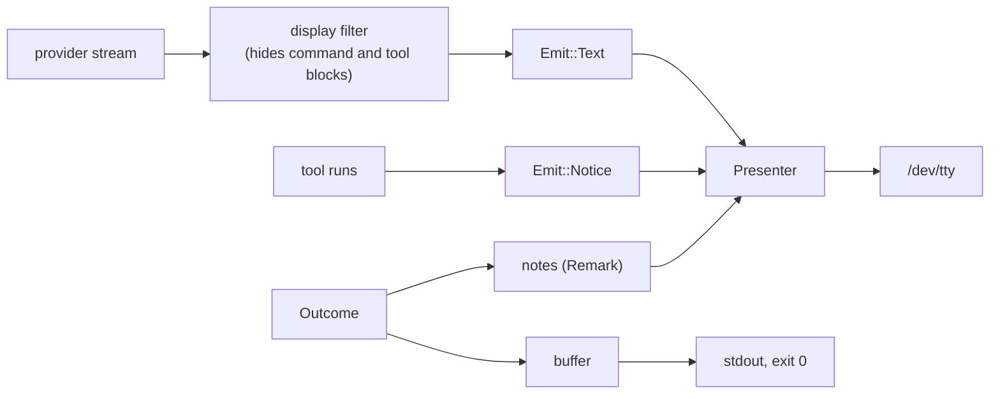

The engine never prints. It says what happened as values, and the binary hands those to a **presenter** that turns them into bytes. This keeps the engine testable with plain strings and means a new look is a new presenter, not a change to the engine.

## Two channels

`shellmate invoke` writes to two places, and never mixes them:

| Channel | Carries | Read by |
|---|---|---|
| `/dev/tty` | Everything you see: the answer, notices, notes, the spinner, errors, the approval prompt | You |
| stdout | Only the new input line, when there is one | The shell glue |

Because the display goes to `/dev/tty` and not to stdout, the glue can capture stdout without losing the answer. With no terminal (tests, pipes), the display goes to stderr instead.

## From the stream to the screen

### 1. Hiding blocks as they stream

The model's reply contains prose and fenced blocks. Two labels matter: `shellmate-command` (a suggestion for you) and `shellmate-tool` (a call for shellmate). Neither should be shown as it streams, so a **display filter** removes them from the text as it arrives.

The filter must not delay ordinary text. It passes characters straight through, and holds back only a line that could still turn out to be a fence opener (it starts with a backtick, or is still shorter than three). Once a line is known to be ordinary it is released at once. A test checks that the filter gives the same text as the final parse for any way of splitting the stream.

The final parse (`response::parse`) is separate. It extracts the command blocks, the tool blocks, and the prose, and drops any command block that contains a control character or a look-alike or direction-changing character, so one can never reach your input line. Those are counted and reported: "(dropped N suggestion(s) containing control characters)".

### 2. What the engine emits

The engine calls a callback with one of two things:

| Emit | When | Look |
|---|---|---|
| `Text` | A piece of the answer, with blocks removed | Answer text |
| `Notice` | A tool ran, was refused, or was moved to your prompt | A line with a symbol, a tone, an optional status and a few detail lines |

`generate` is command-only, so its prose is not streamed. If the model answers with a clarifying question instead of a command, that text is printed at the end. With `[ui] stream = false`, all text is printed at the end.

### 3. The presenter

`Presenter` has one method per kind of output: `answer`, `notice`, `finish`, `remarks`, `error`, `status`, `spinner`, `clear_spinner`, `bullet`, `label` and `cli_error`. Each returns the bytes to write and touches no terminal.

There are two implementations:

- `PlainPresenter` is text only. It wraps words to the terminal width and writes no escape sequences, and it leaves markdown as written.
- `RichPresenter` formats the markdown in answers and draws tones in colour or in bold and italic, over the same text.

`presenter(caps)` picks one from what the terminal can show. The level is decided once per run from the config and the environment (`[ui] color`, `NO_COLOR`, `CLICOLOR`, `CLICOLOR_FORCE`, `TERM`, whether the stream is a terminal), and the locale decides whether symbols are Unicode or ASCII. The full table is in [Colours and formatting](../../guides/output/).

### 4. Words, wrapping and markdown

Answer text is **word wrapped** as it streams. Words are held back until they are complete, so a result can be empty, and a word is never split across a write.

In the rich presenter the markdown reader sits in front of the wrapper. It reads one character at a time with explicit state, so the result cannot depend on how the text was split into chunks. It supports headings, bullet and numbered lists (nested by indentation), quotes, rules, fenced code blocks, and `**strong**`, `*emphasis*`, `_emphasis_` and `` `code` ``. Tables and links are shown as written. A span that never closes is shown literally after a bound of 4000 characters, so a stray `*` cannot hold output back forever.

Styles come from a theme that maps each kind of text to a look and reduces it to what the terminal can show. The palette is the 16 basic terminal colours, so it follows your terminal's own theme.

### 5. Notices and notes

A **notice** is something that happened while the request ran. It has a tone (info, success, warning, error, muted), a mark (a symbol), text, an optional status in brackets and detail lines. A tool that ran and succeeded is green, a failure or refusal is yellow, a command moved to your prompt is cyan, and the first lines of command output are dim. A notice that arrives while the answer is mid-line starts on a new line.

A **remark** is a note after the answer. It has a tone, an optional label and optional listed items: "Other options" with the alternative commands, `check:` findings from [Command checks](../command-checks/), and `note:` for things like earlier turns left out or a store that could not save.

Both are values with a tone, never strings with symbols in them. The presenter decides how a tone looks.

### 6. The spinner

If nothing has been written 300 ms after the request started, and the output is a terminal, a spinner is drawn on the current line and redrawn every 80 ms. The first thing written erases it.

## Why model text cannot control your terminal

Text from the model, from tools, and from your commands is **escaped before it is drawn**, whatever the colour setting. Control characters (including ESC, so no colour, cursor move, title or clipboard sequence), look-alike and direction-changing characters, zero-width characters and byte-order marks become visible text such as `\u{1b}`. A test over generated input checks this.

The only escape sequences shellmate writes are its own theme styles and the line erase for the spinner, and they are all written by the theme. Command text shown in an approval prompt is escaped the same way, so you read exactly what will run.

## Handing over the buffer

If the answer has a command, it goes to stdout and the process exits `0`. The glue replaces your input line with it and puts the cursor at the end. The command is never styled, and never run.

| Exit | What the glue does |
|---|---|
| `0` | Replace the input line with stdout |
| `10` | Leave the line as it is |
| other | An error was already shown; leave the line |

The command comes from the first `shellmate-command` block. If the model offered more than one, the others are listed as "Other options" and are not placed anywhere. If you chose `b` at an `exec` approval prompt, that command is placed in the line when the model did not suggest one.

## Terminal state and typeahead

While shellmate works, the terminal stays in canonical mode with only echo off and Ctrl-C still delivered, so what you type stays queued for the shell. The saved settings are restored on every exit path.

When the request is over, anything typed during the wait is discarded, whatever the outcome (answer, explanation, error, cancel). Otherwise an Enter pressed too early could run a line you have not reviewed. If an Enter was among what was discarded, you see a notice.

## `--explain` and `--timings`

These add text after the answer. `--explain` prints what was used: provider chain and which answered, trust, level, redaction, conversation and turn, tools, and token counts. `--timings` prints where the time went. Neither contains prompts or answers. See [Audit log and --explain](../../guides/audit/).

## Previewing a look

`shellmate render FILE` shows a markdown file the way an answer would look, with `--color`, `--width`, `--ascii` and `--no-markdown` to try other settings.
