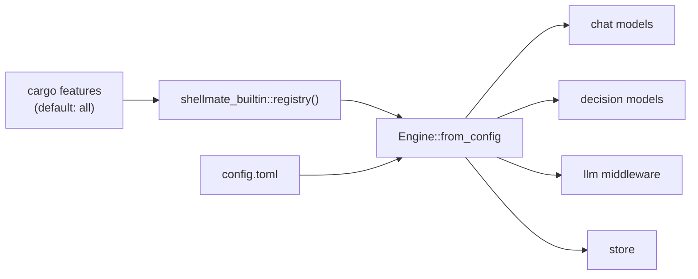

shellmate has five kinds of plugin. They depend only on the plugin API crate (`shellmate-api`), and the first-party ones are compiled into the binary and registered through cargo features. Outside plugins are designed but not built, so the only plugin ids that exist are `builtin:<id>`.

The fifth kind, tools (`man`, `exec`, `read`), is described in [Tool calling](../tool-calling/). A tool does the work for a call. The core decides whether the call may go ahead.

## The kinds at a glance

| Kind | Trait | Built-in plugins | How many | Required? | Called |
|---|---|---|---|---|---|
| Provider (chat model) | `Provider` | `builtin:openai-compatible` | One or more, tried in order | Yes, for `ask`, `generate` and `explain` | Once per model round, in order until one answers |
| Decider (decision model) | `Decider` | `builtin:systemone` | Zero or more, tried in order | No | After an answer, when `[validator] chain` is not empty |
| `llm` middleware | `Middleware<ChatRequest, ChatStream>` | `builtin:redact` | Zero or more, stacked | Only if a model's provider is `remote` | Around every provider call, and around remote decider calls |
| Store | `Store` | `builtin:store-tmpfs` | One, or none | No | When a request starts and when it ends |
| Tool | `Tool` | `man`, `exec`, `read` | Any number, offered in registration order | No | When the model asks for it in the tool loop |

"Required" means what the engine needs to work, not what you must configure. A fresh `shellmate setup` writes a provider and a model for you.

## How plugins are found and built



1. `shellmate_builtin::registry()` creates a `Registry` and asks each compiled-in plugin to register a **constructor** under its id (`openai-compatible`, `systemone`, `redact`, `store-tmpfs`, `man`, `exec`, `read`).
2. The engine reads the config, and for each plugin the config names, looks the constructor up by id and calls it with that plugin's settings, converted to JSON, with secret references already resolved. For a model, the settings are those of its provider and its own, in one object.
3. An id the registry does not know fails with `config.unknown_plugin`, and the hint lists the ids that exist. An id without the `builtin:` prefix fails with `config.unsupported`.

Constructors must be cheap. They build an object and check the settings. They never open the network, because start-up has a 30 ms budget. A constructor rejects unknown or mistyped settings with a `config.*` error.

`shellmate config check` builds every model, middleware layer and tool in the config and opens the store, without sending anything and without running the `cmd:` secret program of a model, so a typo is caught before a request. It also applies the privacy rule: a remote model, chat or decision, is refused unless a redaction layer is active.

### Settings and secrets

A model has two tables. The provider is the connection and the model is what is used from it:

```toml
[providers.openrouter]
trust = "remote"                 # "local" or "remote" (default "remote")
max_context_level = 1            # optional ceiling, see Context and prompts
preset = "openrouter"            # the rest is handed to the plugin as is

[models.main]
provider = "openrouter"
plugin = "builtin:openai-compatible"
model = "~openai/gpt-luna-latest"   # the rest is handed to the plugin as is
```

The core keeps `trust` and `max_context_level` (provider) and `provider` and `plugin` (model). Everything else goes to the plugin, which rejects keys it does not know. A key is in one table, never both. The plugin id says whether a model is a chat model or a decision model.

Middleware and the store use `[plugins."builtin:<id>"]`, with `enabled` and then the plugin's own keys next to it. The store id itself is `[conversation] store`.

Any setting whose name looks like a secret (`api_key`, `token`, `password`, `secret`, or a name ending in `_key`, `_token` or `_secret`) must be a reference: `env:NAME`, `file:PATH`, `cmd:PROGRAM ARGS` or `keyring:service/account`. A literal value is refused. Plugins receive the resolved string wrapped in `Secret`, so it cannot be printed by accident.

## Provider

A provider plugin turns a chat request into a stream of text. In the config it is the `plugin` of a `[models.<name>]`. The trait has `info` (plugin, model, endpoint), an optional `prepare` (get ready: this is where a lazy `cmd:` secret is fetched), `chat`, and `chat_stream` (which defaults to one event holding the whole answer).

- **More than one:** yes. `[llm] chain` lists model names, primary first, then fallbacks. A model that is defined but not in a chain is never built and never called. A decision model in this chain is refused.
- **When it is called:** once per round of the tool loop, for the first model in the chain, and for the next ones only if the first fails in a way that allows a fallback. See [The LLM pipeline](../llm-pipeline/).
- **Trust:** each provider table is `local` or `remote`, default `remote`, and its models share it. Trust sets the default context ceiling (3 for local, 1 for remote), decides which earlier turns it may be shown, and decides whether redaction is mandatory.
- **To turn one off:** remove it from `[llm] chain` (or delete its table). There is no `enabled` key on a model.
- **Built in:** `builtin:openai-compatible` talks to any server that implements `/chat/completions` with streaming: OpenRouter, OpenAI, Ollama, LM Studio, LocalAI, or an `endpoint` you give. Cleartext `http` is accepted only for loopback hosts.

## Decider

A decider plugin answers typed questions about a command, with a label and probabilities, and no free text. In the config it is the `plugin` of a `[models.<name>]`. It is used only by the optional semantic check (see [Command checks](../command-checks/)).

- **More than one:** yes. `[validator] chain` lists model names, tried in order. The first one that answers wins. A chat model can be in the chain too.
- **When it is called:** after the answer is complete, for `ask` and `generate` when a command was suggested, and only if `[validator] chain` is not empty. The call has its own timeout (`[validator] timeout`, default 5 s).
- **Fallback:** the next model in the chain. A chat model there answers the same questions as a chat request. If none answers, the check is skipped with a note.
- **Trust:** one on a `local` provider gets the record as is. One on a `remote` provider gets it after it has been through the redaction chain, and is refused when no redactor is active.
- **To turn one off:** take it out of `[validator] chain`.
- **Built in:** `builtin:systemone` speaks the System One wire format (`POST {endpoint}/v1/systemone`), served by hosted APIs such as TypeSafe and OpenRouter, Ollama decision models and Ollaya.

## `llm` middleware

Middleware wraps the provider call like layers of an onion. Each layer can change the request on the way in and the response on the way out, and can call the next layer once, or not at all if it answers by itself.

- **More than one:** yes. `[pipeline] llm` is the list, outermost first. The default is `["..."]`, and `"..."` stands for the built-in defaults, today just `builtin:redact`.
- **When it is called:** around **every** provider call: each round of the tool loop, each fallback model, a remote decision model's request, and a chat model answering the semantic questions. Not around a local decision model.
- **Roles:** a middleware declares a role when it registers. `Redactor` hides sensitive data, `Filter` rewrites for other reasons, `Observer` only watches. The core uses the role to enforce INV-2, so never declare one you do not fulfil.
- **To turn one off:** `[plugins."builtin:redact"] enabled = false`, or leave it out of `[pipeline] llm`. Turning the redactor off while a model on a remote provider is in a chain makes the engine refuse to run (`privacy.no_redaction`), unless you set that provider's `trust = "local"`.
- **Built in:** `builtin:redact`. See [The LLM pipeline](../llm-pipeline/) for what it replaces and how it restores.

## Store

A store keeps conversations. The core owns the turn format and gives the store opaque JSON values. A store only has to keep order, append atomically, and lock a conversation across processes.

- **More than one:** no. `[conversation] store` names exactly one store, or `"none"`.
- **When it is called:** when a request starts (find the session's conversation and lock it), when it ends (append the turn), and by the `shellmate conversation` commands.
- **Required:** no. With `store = "none"`, every request is stateless. If the configured store cannot be opened, conversations are turned off for that run and you get a note. shellmate never silently switches to another store.
- **To turn it off:** `store = "none"`, or set `[actions.<name>] conversation = "fresh"` for one action.
- **Built in:** `builtin:store-tmpfs` keeps one JSON-lines file per conversation on tmpfs, with advisory `flock` locks, so transcripts disappear at logout. See [State on disk](../state-and-storage/).

## Tool

A tool lets the model look at something before it answers. It is configured by `[tools.<name>]`, and every registered tool is on unless you turn it off. The core reads three keys from the table (`enabled`, `approval`, `preapproved`) and hands the rest to the tool, which rejects keys it does not know.

- **More than one:** yes. They are offered to the model in registration order: `man`, `exec`, `read`.
- **When it is called:** when a reply holds a `shellmate-tool` block naming it. See [Tool calling](../tool-calling/).
- **What the tool decides:** whether a call is well formed, how risky it is, and whether it needs a person. **What the core decides:** whether a tool that says it needs approval can skip it (it cannot), whether a pre-approval rule may apply (only to a call the tool marks preapprovable, on an untainted turn, with your rule), who may answer yes (only the prompt in the binary), whether the turn is tainted, and escaping of everything the tool shows.
- **To turn one off:** `[tools.<name>] enabled = false` or `approval = "deny"`.
- **Built in:** `man`, `exec` and `read`, each behind a cargo feature (`tool-man`, `tool-exec`, `tool-read`).

## Turning things on and off

| Thing | On | Off |
|---|---|---|
| A chat model | Put it in `[llm] chain` | Take it out of the chain |
| A decision model | List it in `[validator] chain` | Take it out of the chain |
| Redaction | Default | `[plugins."builtin:redact"] enabled = false` (needs no remote providers) |
| A middleware | List it in `[pipeline] llm` | Remove it, or `enabled = false` |
| Conversations | Default (`builtin:store-tmpfs`) | `[conversation] store = "none"` |
| The command check | `[validator] enabled = true` (default) | `enabled = false` |
| A tool | `[tools.<name>] enabled = true` | `enabled = false` or `approval = "deny"` |

Turning a tool off also removes its instructions from the prompt, so the model is not told it exists.

At build time you can leave a plugin out entirely with cargo features (`--no-default-features --features ...`). A config that names a plugin that is not compiled in fails with `config.unknown_plugin`.

## The rules plugins cannot break

Plugins add capability, never trust. These hold whatever is installed:

- A plugin cannot approve a command. The approval prompt is implemented only in the binary, and a plugin can only make approval stricter.
- A request reaches a network provider only through the whole outbound chain, and a remote provider needs a redactor (INV-2).
- Secrets reach plugins only as the references you wrote, resolved by the core.
- The audit log records what shellmate did, never prompts, answers or tool results.

See [Security model](../security-model/) for the full list.
