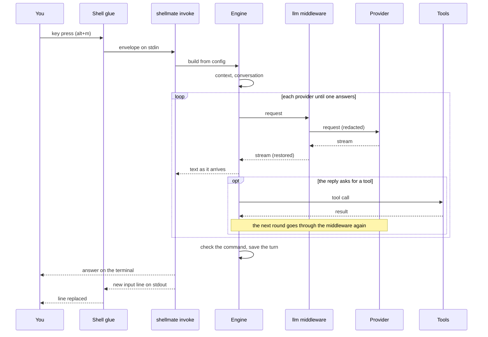

This page follows one `ask` request from the key press to the new input line. Later pages go deeper into the parts: [plugins](../plugins/), the [LLM pipeline](../llm-pipeline/), [tool calling](../tool-calling/), [context and prompts](../context-and-prompts/), [command checks](../command-checks/), [state on disk](../state-and-storage/) and [output](../output-and-presentation/).

## The whole path

## Step by step

### 1. The shell glue

The glue is a small script that `shellmate init <shell>` generates. It has hooks that remember the last exit status, the last command and a short ring of recent commands. When you press a shortcut, its widget:

1. Writes an **envelope** (see [Shell glue](../glue-protocol/)) to a private file named after the shell's process id, in `$XDG_RUNTIME_DIR/shellmate` (or `/tmp/shellmate`).
2. Runs `shellmate invoke` with that file as stdin and another private file as stdout.
3. After the process exits, reads the result file and replaces the input line if the exit code says so.

The glue never talks to a model and never runs what comes back. Anything that can be tested lives in the binary.

### 2. The process starts

`main` parses the command line and calls `invoke::run`. This opens `/dev/tty` (never stdout, which is reserved for the new input line), turns echo off while keeping Ctrl-C working, and builds a single-threaded async runtime. Each request is a new process.

### 3. The envelope is read

`Envelope::parse` reads NUL-separated `key=value` fields. It requires `v=1` and an `action`, ignores fields it does not know, and refuses an input line over 64 KiB. A bad envelope fails with `glue.protocol`, `glue.version` or `input.too_large`.

The `capture` action stops here. It wraps or unwraps the input line in `shellmate run --`, touches no config and no provider, and exits (see [Asking about a command's output](../../guides/capture/)).

### 4. The engine is built

`Config::load` reads `$XDG_CONFIG_HOME/shellmate/config.toml` (or the `--config` path). A missing default file gives the built-in defaults. `Engine::from_config` then builds, from the config and the plugin registry:

| Part | Built from | Notes |
|---|---|---|
| Providers | `[llm] chain`, each `[providers.<name>]` | Only the providers in the chain are built. |
| Deciders | `[validator] deciders` | Only when `[validator] semantic = true`. |
| `llm` middleware | `[pipeline] llm` | Minus plugins with `enabled = false`. |
| Store | `[conversation] store` | An unusable store turns conversations off, with a note. |
| Audit sink | `[audit]` | Absent when `enabled = false`. |

Secret references (`env:`, `file:`, `cmd:`) in plugin settings are resolved here. A `cmd:` secret is not run yet: the provider is built twice, once with a placeholder to check the settings, and again on first use with the real value. A fallback provider that is never called never runs its program.

Then `check_privacy` runs (INV-2): a provider or decider with `trust = "remote"` is refused unless a plugin with the `Redactor` role is active. See [The LLM pipeline](../llm-pipeline/).

If the terminal exists, a `TtyApprover` is attached so that tools can ask you. Without one, every model-driven command is denied.

### 5. `--dry-run` stops here

With `--dry-run`, the engine builds the real payload for each provider, runs it through the middleware into a recording terminal instead of a provider, prints it, and exits. Nothing is sent.

### 6. `run_streaming`

This is the engine's main function. In order:

1. `check_privacy` again, so no construction path can skip it.
2. Parse the action. `new-conversation` is answered here: it starts a conversation and returns, with no model call.
3. Require at least one provider (`config.no_provider` otherwise).
4. **Prefetch context.** The project and git collectors run on a blocking thread, only if the context level can carry them. See [Context and prompts](../context-and-prompts/).
5. **Resolve the conversation.** The store picks or creates the session's conversation and **locks it for the whole turn**, so two requests in one session cannot interleave (`conversation.busy` after a 2 second wait). See [State on disk](../state-and-storage/).
6. Create a request id and write the `request_started` audit event.
7. **Try the providers in order.** For each one:
   1. `build_request` rebuilds everything for this provider: the context level (the smaller of your default and the provider's ceiling), the history it may see, the tool instructions, and the system prompt.
   2. `attempt` runs the model turn: it calls `prepare` (fetching a lazy secret), then loops. Each round sends the request through the middleware chain, streams the reply, and, if the reply asks for a tool, runs it and goes round again. See [Tool calling](../tool-calling/).
   3. If it fails before anything was shown or run, and the error is `provider.timeout`, `provider.unavailable` or `provider.rate_limited`, the next provider is tried. Any other error ends the request.
8. `finish` parses the final text into an `Outcome`: the prose, the first command block as the **buffer**, other command blocks as "Other options", and a count of blocks dropped for control characters. An answer with nothing at all fails with `answer.empty`.
9. **Check the command** (`ask` and `generate` only). Syntax, programs, risk, and optionally a decision model. The findings become notes. See [Command checks](../command-checks/).
10. Build the `--explain` report and write the `turn_finished` audit event.
11. **Save the turn** in the conversation. A store that cannot save does not fail the request: you get a note.

### 7. Output while it runs

The engine does not print. It calls a callback with `Emit::Text` (a piece of the answer, with command blocks removed) or `Emit::Notice` (a tool ran or was refused). The binary hands those to a **presenter**, which turns them into bytes for the terminal.

If nothing has appeared after 300 ms, a spinner is drawn. Ctrl-C drops the request: the response stream closes, the connection ends and generation stops. You see `[cancelled]` and the input line is left alone. See [Output and presentation](../output-and-presentation/).

### 8. The end

After the engine returns, `invoke` prints what the presenter still holds back, then the notes (other options, checks, warnings), then `--explain` and `--timings` output if you asked.

It then hands the buffer to the glue:

| Exit code | Meaning |
|---|---|
| `0` | Replace the input line with what is on stdout. |
| `10` | Leave the input line as it is (an explanation, an answer with no command, a cancel). |
| anything else | An error, already shown on the terminal. |

Finally, anything you typed while shellmate was working is thrown away, whatever the outcome. An Enter pressed during the wait must never reach the shell and run a line you have not reviewed. If an Enter was among what was discarded, you are told.

## What stops a request

| Stage | Typical errors |
|---|---|
| Envelope | `glue.protocol`, `glue.version`, `input.too_large` |
| Config | `config.invalid`, `config.unsupported`, `config.unknown_plugin`, `config.secret_cmd_failed` |
| Privacy gate | `privacy.no_redaction` |
| Setup | `config.no_provider`, `input.empty` |
| Conversation | `conversation.busy` |
| Provider | `provider.timeout`, `provider.unavailable`, `provider.rate_limited` (these fall back), `provider.auth`, `provider.bad_request`, `provider.content_filtered`, `provider.error` (these do not) |
| Answer | `answer.empty` |

Every error carries a hint that says what you can do. `shellmate doctor` checks most of these ahead of time.

## Where the time goes

A run takes about 8 ms before any network traffic. `--timings` splits one request into the start-up of the process, gathering context, the model (including tool runs and approvals), the checks on the command, and the rest. See [Audit log and --explain](../../guides/audit/).
