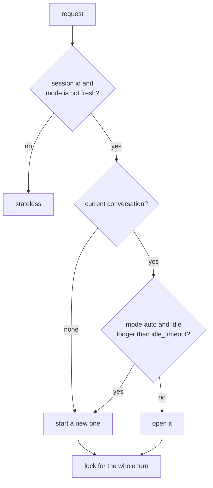

shellmate has no daemon and keeps nothing in memory between requests, so everything it remembers is a file. This page lists them all, then explains the conversation model, which is the part with rules.

## Every file

| What | Path | Written by | Lives until |
|---|---|---|---|
| Config | `$XDG_CONFIG_HOME/shellmate/config.toml` (or `~/.config/shellmate/config.toml`, or `--config`) | You, `setup`, `config init` | You delete it. It is only read at run time. |
| Glue request and result | `$XDG_RUNTIME_DIR/shellmate/<shell pid>.in` and `.out` (`/tmp/shellmate` without a runtime dir) | The shell glue | Emptied after each request |
| Conversations | `$XDG_RUNTIME_DIR/shellmate/store/conv/<id>.jsonl` | `builtin:store-tmpfs` | Logout (tmpfs) or until cleared |
| Session pointers | `.../store/sess/<session>` | `builtin:store-tmpfs` | Logout |
| Conversation locks | `.../store/conv/<id>.lock` | `builtin:store-tmpfs` | While a request holds it |
| Captured output | `$XDG_RUNTIME_DIR/shellmate/capture/<session>` | `shellmate run` | Replaced by the next capture, or logout |
| Audit log | `$XDG_RUNTIME_DIR/shellmate/audit.jsonl`, or with `persist = true` `$XDG_STATE_HOME/shellmate/audit/audit.jsonl` | The engine | Logout, or the retention you set |
| Shell rc block | Your shell's rc file | `install-shell` and `setup` | Until `install-shell --remove` |

Without `$XDG_RUNTIME_DIR`, the store, captures and audit use `/tmp/shellmate-<uid>/`. The store creates its files as mode `0600` inside directories of mode `0700`.

Nothing here is a secret store. The one sensitive value is a conversation's **redaction key** (16 random bytes in the conversation header), which only makes placeholders stable across turns. It lives on tmpfs next to the transcript.

## Conversations

A conversation is the list of turns a shell session has had with the model, so a follow-up such as "now make it recursive" has something to follow.

### Which conversation a request continues

The shell glue exports a **session id** (`SHELLMATE_SESSION`), fresh for each interactive shell. The store keeps a pointer from the session to its current conversation. For each request, `[conversation]` and `[actions.<name>]` decide what happens:

| Mode | Behaviour |
|---|---|
| `auto` (default) | Continue the current conversation, unless it has been idle longer than `idle_timeout` (30 minutes by default). Then start a new one. |
| `continue` | Always continue. Create one if there is none. |
| `fresh` | Stateless. Read nothing, write nothing. |

A request with no session (not called from the glue) is stateless. `[actions.ask] idle_timeout` overrides the global idle timeout for one action.

### The lock

The conversation is locked when the request resolves it, and the lock is held until the turn is saved. A second request in the same session waits up to 2 seconds and then fails with `conversation.busy`. This stops two requests from interleaving turns. The lock is an advisory `flock`, so it disappears if the process dies.

### What a turn holds

One turn is one request and everything that followed until the final answer:

| Field | Meaning |
|---|---|
| `at` | When it finished (Unix seconds) |
| `action`, `input` | The action, and what the input line held |
| `level` | The context level the answering provider got (a summary, not the context) |
| `audience` | `local` or `any`, see below |
| `provider` | Which provider answered |
| `suggestion` | The command left in the input line, if any |
| `messages` | The user message, any tool calls and results, and the answer, each tagged as text, tool call or tool result |
| `outcome` | `completed` or `interrupted` |

The context itself (environment, recent commands, git) is **not** stored. It is rebuilt for every turn.

The store keeps at most `max_turns` per conversation (default 40) and drops the oldest.

### What is replayed, and to whom

`conversation::assemble` turns stored turns into the history for one provider:

1. **Window.** Only the most recent `keep_recent_turns` turns (default 6) are considered.
2. **Audience.** A turn answered with level 2 or above context is tagged `local`, because its answer may repeat that context. A `remote` provider is never shown a `local` turn. The turns left out are counted, and you are told: "N earlier turn(s) were not sent to X (restricted to local models)". Tags only ever get stricter.
3. **Elision.** In a turn older than `elide_tool_results_after` (default 2), tool results are replaced by a stub that states their size.
4. Whole turns only, so a tool call never loses its result.

### The store plugin contract

The core owns the format. A store implements `Store` and only has to be ordered, atomic per append, and lockable. The methods are: `current`, `set_current`, `create`, `read`, `append_turn`, `pop_turn`, `list`, `delete`, `clear` and `lock`. See [Plugins](../plugins/).

`builtin:store-tmpfs` writes one JSON-lines file per conversation (a header line, then one turn per line). A turn is appended with a single write, so a concurrent reader sees it whole or not at all. Trimming to `max_turns` and updating a session pointer go through a temporary file and a rename. A store directory that another user owns or can read is refused (`conversation.store`), and conversations are then off for that run, with a note.

The `shellmate conversation` commands (`list`, `show`, `new`, and others) work on the same store. See [Follow-up conversations](../../guides/conversations/).

## Captured output

`shellmate run -- <command>` runs the command as usual, with its output on pipes, and keeps a bounded copy for the **next** request. The copy holds the command, its exit status, the time, the output with terminal escapes removed, and whether it was cut. At most 64 KiB is kept (the start and the end, with the middle removed). It is private to the session and holds only the last command.

When the next request is built at level 2 or above, the capture is included if it is under an hour old, cut to `[context] capture_bytes`. It is untrusted data, so it taints the request. See [Context and prompts](../context-and-prompts/) and [Tool calling](../tool-calling/).

## The audit log

An append-only file of JSON lines recording what shellmate did: which provider, how long, which tool and what was decided. It never holds prompts, answers or tool results. A failure to write is swallowed and never blocks a request.

By default it is volatile. With `[audit] persist = true` it moves to the state directory, and old events are pruned by `retention` (30 days) and by `max_bytes` (10 MiB) when new ones are written. The events are listed in [Audit log and --explain](../../guides/audit/).

## What reads and writes what

| Component | Reads | Writes |
|---|---|---|
| Shell glue | Its own variables, the result file | The request file, the input line |
| `invoke` | Config, the request file (stdin), `/dev/tty` | Terminal output, the new buffer (stdout) |
| Engine | Capture, conversation, `/etc/os-release`, the project and git state | Conversation turns, audit events |
| `shellmate run` | Nothing | The capture file |
| Tools | Files and programs, through the checks in [Tool calling](../tool-calling/) | Nothing (`exec` runs programs you approved, which may do anything a program can) |
| `setup`, `config init`, `install-shell` | Config, rc file | Config, rc file |

The core reads environment variables, the clock and files through three small ports (`Env`, `Clock`, `Fs`, bundled as `Host`), so tests can give it a fixed machine. Starting programs, the `read` tool's path checks and anything that writes use the real system on purpose.
